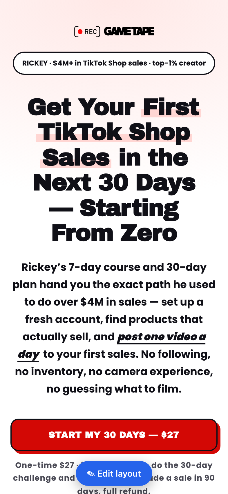
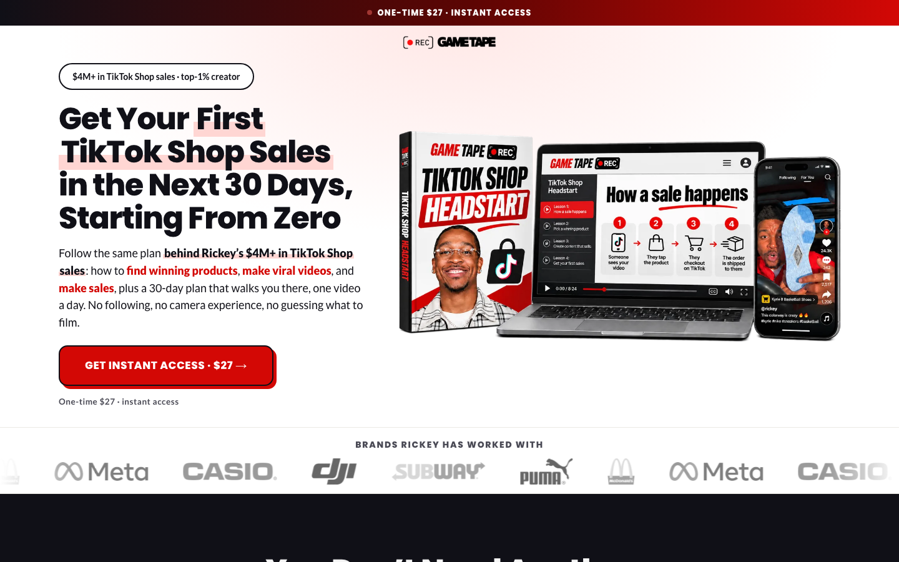

# Sales Page Playbook

**Build a sales page as good as Rickey's TikTok Shop Headstart page, for any offer, with Claude Code.**

On Nov 20 2026, David and Claude built that page in one day. The steps were:
- copy from Isabelle's AI Sales Page Tool, reworked with a landing-page framework;
- the Sales Page Generator kit;
- ChatGPT images, real TikTok screenshots, sliders and video loops;
- 12 rounds of detailed feedback on mobile and desktop;
- a speed pass, then GitHub.

This repo packages all of it: the process, every tool and link, every rule the feedback produced, the components, the full worked example, and a test that proves someone else can repeat it.

| Before (first draft) | After (final), phone | After (final), desktop |
|---|---|---|
|  |  |  |
| 13 different button labels, dashes, "steal", placeholder links. **Auto grade 25/50** | **Auto grade 50/50**, live at https://shuri-lab.github.io/rickey-tiktokshop-project/ | |

## Start in 2 minutes
1. **Get the playbook.** Use either:
   - the zip you were sent: unzip it anywhere, for example `~/landing-pages-skill`;
   - or clone the repo:
   ```bash
   git clone https://github.com/shuri-lab/landing-pages-skill.git
   ```
   Everything is inside the folder: the kit, the frameworks, the tools, and the full Rickey project files. No other downloads are needed.
2. **Put the client's files in one folder.** That's research, offer documents, brand guide, photos, videos and screenshots.
3. **Open Claude Code** (desktop app, Code tab, recommended because it has a built-in browser) on that project folder. Then say:
   > Read `<path to>/sales-page-playbook/START-HERE.md` and start. The project files are in this folder.

   Or install the skill: copy `.claude/skills/sales-page-playbook/` into `~/.claude/skills/`, then just say "build a sales page with the sales page playbook".
4. **Answer Claude's questions.** Then do the hands-on parts it asks for: running the image prompts in ChatGPT, and grabbing screenshots. Give feedback on the page.

**You need:**
- Claude Code
- Python 3
- Node 22+
- Google Chrome
- Pillow, for the speed step: `python3 -m pip install Pillow`
- A ChatGPT account for images
- The Buy-Now Sales Page portal login (ask TJ)

## The 9 stages

| # | Stage | What happens | Hands-on for you |
|---|---|---|---|
| 0 | Setup | Folders, tools checked | none |
| 1 | Context | Claude reads everything and writes a sourced Project Brief: offer, avatar, proof, voice | Confirm the summary |
| 2 | Copy | [AI Sales Page Tool](https://tasteofreedom.com/the-buy-now-sales-page-tool-page) filled from the brief (2 runs). Hero reworked with the [landing-page framework](knowledge/frameworks/HOW-WE-USE-THEM.md). Checked against the kit's 14 sections. House copy rules applied | Pick the hero, set the values |
| 3 | Brand | Colors from the brand guide, role map, contrast check, Google Fonts, shown as swatches | "Feels like us?" |
| 4 | Media | Image plan, ChatGPT prompts in one batch, screenshots list. Claude checks and places everything | Run the prompts, grab screenshots/photos |
| 5 | Build | Kit build with the house style from the first draft (alert bar, hero above the fold, logo slider, video carousel, offer stack, guarantee, sticky CTA…) | none |
| 6 | Self-review | Auto grade, screenshots at phone and desktop size, every section checked, fixed **before** you see it | none |
| 7 | Feedback | Your rounds; each one logged so it's never needed again | Your feedback |
| 8 | Speed | WebP at display size, light video loops: about 15 MB → 1.2 MB | none |
| 9 | Share | GitHub repo + Pages link, README, paste-ready file for any builder | Create the repo |

## What's inside

| Folder | What |
|---|---|
| [`START-HERE.md`](START-HERE.md) | The instructions Claude follows |
| [`stages/`](stages/) | One file per stage: steps, rules, done-when |
| [`knowledge/house-style.md`](knowledge/house-style.md) | **The 27 defaults every page gets from the first build.** This is what David's feedback taught us |
| [`knowledge/copy-context.md`](knowledge/copy-context.md) · [`copy-fallback.md`](knowledge/copy-fallback.md) | What context the copy needs (with a gate) · how Claude writes the draft itself if the copy tool is down |
| [`knowledge/copy-rules.md`](knowledge/copy-rules.md) | Copy rules (no dashes, 5th-grade clarity, one CTA label, never invent…) |
| [`knowledge/review-checklist.md`](knowledge/review-checklist.md) | The pass/fail checklist |
| [`knowledge/feedback-log.md`](knowledge/feedback-log.md) | Every piece of feedback: what David said → the general rule → how it was built |
| [`knowledge/components/CATALOGUE.md`](knowledge/components/CATALOGUE.md) | Every component (alert bar, sliders that never run out, sticky CTA, offer stack…) with code pointers |
| [`knowledge/frameworks/`](knowledge/frameworks/) | Landing-pages framework v2, Hormozi VSL framework, ThrillX prompts, and how we use them |
| [`knowledge/tools-and-links.md`](knowledge/tools-and-links.md) | Every tool and link |
| [`knowledge/references.md`](knowledge/references.md) | JJ pages and repos and other references, and what we took from each |
| [`knowledge/upsell-and-bump.md`](knowledge/upsell-and-bump.md) | The upsell page, checkout column and order bump |
| [`kit/`](kit/) | **The complete "Sales Page Generator - for clients" folder** (Isabelle's kit, the build engine), unchanged, including the original zips and the 42 brand palettes |
| [`tools/`](tools/) | `rebuild.sh`, `expand_body.py`, `optimize_images.py`, `shoot.mjs` (phone/desktop screenshots + fold measurements), Mac helpers |
| [`examples/rickey-headstart/`](examples/rickey-headstart/) | The full worked example: brief, tool inputs and output, final copy, brand kit, page source, learned rules, image prompts, screenshots, the day's timeline. Plus **the complete "Rickey-TikTokShop-Project-Files" folder** (`project-files/`) and extra context (`more-context/`: meeting transcripts, the plan, the knowledge base) |

Every folder has its own `README.md`.
| [`test/`](test/) | **The replication test:** rebuild Rickey's page from the raw inputs; graded 50 automatic + 50 by TJ |

## The test (for Moses, or anyone new)
Read [`test/TEST.md`](test/TEST.md). Then:
- In Claude Code, say: "Take the sales page playbook test".
- Hand in your `my-sales-page/` folder.
- TJ grades it with [`test/rubric.md`](test/rubric.md) and [`test/tj-review-sheet.md`](test/tj-review-sheet.md). **Pass: 85/100 and no hard fail.**

## Out of scope
GoHighLevel setup (checkout, order bump, one-click upsell, course delivery) will be a separate skill. Notes for it: [`knowledge/ghl-notes-for-later.md`](knowledge/ghl-notes-for-later.md).
